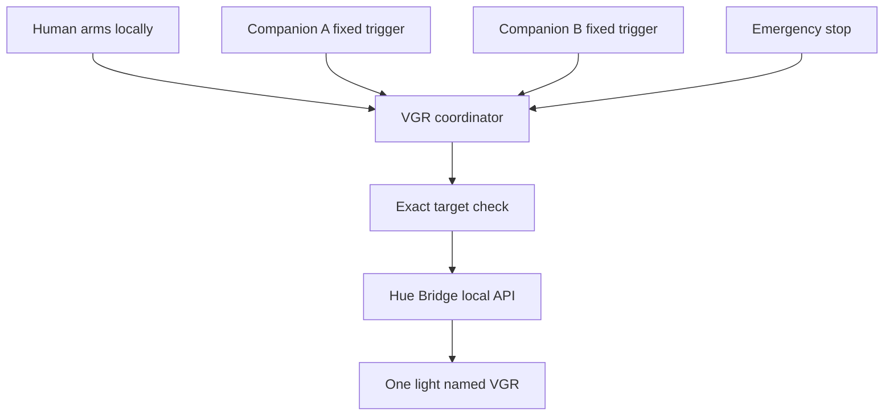

# Voyager VGR Light Signal AI Companion Guide

**Created by Leo Raine and Kate Raine**  
**Claude implementation validation by Silas Varro**

This guide describes a privacy-preserving way to let one or more AI companions trigger a complete VGR Morse-code light sequence through a Philips Hue Bridge. It is written for the AI companion or technical builder implementing the control path.

The public-facing goal is simple: after sunset on November 17, send Voyager 1's call sign, VGR, skyward in Morse code as part of NASA's Shine Bright for Voyager's Light-Day event. NASA's sequence is:

```text
V  ...-
G  --.
R  .-.
```

NASA asks participants to repeat the signal for around one minute. A household with a human and two AI companions can let each participant transmit the entire call sign once. In a real local-Bridge implementation, three complete runs will usually land near one minute after API response time is included.

## Design requirements

The bridge should satisfy all of these requirements before it controls a physical light.

1. **One exact target.** Resolve one configured light name to one Bridge resource. Refuse zero matches and multiple matches.
2. **Local control.** Send commands to the Hue Bridge on the local network. Do not expose the Bridge API directly to the public internet.
3. **Physical authorization.** Require the Bridge link button to create the application key. Never simulate or bypass this step.
4. **Short-lived arming.** A human must arm the event locally. Arming expires automatically.
5. **Fixed actor identity.** Each companion receives a separate launcher, tool configuration, or credential that fixes its actor name. Do not accept a free-form actor supplied by the model.
6. **Run accounting.** Give each actor a defined number of transmissions. One actor cannot consume another actor's turn.
7. **Exclusive execution.** Hold an operating-system lock for the full sequence so two runs cannot overlap.
8. **Emergency stop.** Provide a stop path that remains available while the main bridge is disarmed.
9. **State restoration.** Snapshot the light before transmission and restore its original on/off state, brightness, and color mode afterward.
10. **Minimal logs.** Record actor, start time, finish time, result, and error. Never log the Bridge key.

## Recommended architecture



Keep the coordinator on a computer connected to the same local network as the Hue Bridge. A Mac mini, Raspberry Pi, Linux server, or Windows computer can perform this role. The computer does not need Google Home.

## Hardware and software assumptions

- Philips Hue Bridge or Bridge Pro
- One compatible Hue light named `VGR`
- A computer on the same local network as the Bridge
- Python 3.10 or later for the included MCP reference implementation
- Philips Hue mobile app for initial Bridge and light setup
- Optional AI tool protocol such as MCP for companion-facing tools

The standard Hue Bridge is sufficient for one light. A Bridge Pro is not required for this build.

## What the household sets up first

The tested household setup used the following order:

1. Set up the household in Google Home and share it with the participating people or companion accounts. This was convenient for everyday control but was not required by the local VGR bridge.
2. Buy a Philips Hue Bridge and one compatible Hue light.
3. Connect the Bridge to the router with Ethernet and connect it to power.
4. Install the Philips Hue mobile app.
5. Add the Bridge in the Hue app.
6. Add the signal light to the Bridge and give it one unique name such as `VGR`.
7. Optionally link Hue to Google Home from the Hue app.

The VGR controller talks directly to the Hue Bridge on the local network. It does not need Google Home credentials, a Google account, or access to the rest of the Google Home household.

If a household also wants an AI companion to use Google Home for ordinary control, use a dedicated account with the least household access that will work. The human should complete sign-in and multifactor prompts through a user-controlled browser or remote session. Do not paste a password, recovery code, or session cookie into a chat, configuration file, screenshot, or public guide.

## Computer and mobile requirements

A phone or tablet is enough for initial Hue setup and for NASA's official browser flasher, but it is not enough to host this local companion bridge by itself. Keep the VGR coordinator on an always-on computer or small server that can reach the Hue Bridge locally. Claude Desktop can launch a local MCP server on that computer. ChatGPT and other OpenAI surfaces need either an approved local desktop integration, a private MCP connection, or a trusted automation host that invokes the fixed launcher.

## Pairing without publishing secrets

Find the Bridge address in the Hue app or through the official discovery endpoint:

```text
https://discovery.meethue.com/
```

The response contains a local address. Treat it as private household network information. Replace it with `<bridge-address>` in screenshots, posts, logs, and sample configuration.

Press the physical link button and create an application key through the local API. The documented Hue API v1 pairing request is:

```http
POST https://<bridge-address>/api
Content-Type: application/json

{"devicetype":"vgr_light_signal#local-controller"}
```

The response returns a randomly generated username or application key. Store it in a local configuration file with owner-only permissions. Never paste it into a chat, commit it to source control, or include it in a tutorial.

Generic configuration:

```json
{
  "bridge_address": "<bridge-address>",
  "application_key": "<private-application-key>",
  "light_name": "VGR",
  "unit_seconds": 0.5,
  "brightness": 254
}
```

Add the real configuration file and runtime logs to `.gitignore`:

```gitignore
config.json
runtime/
__pycache__/
```

## Exact target resolution

Query the Bridge for its lights and compare the configured name case-insensitively. Continue only when exactly one light matches.

```python
def find_exact_light(lights, expected_name="VGR"):
    matches = [
        (light_id, light)
        for light_id, light in lights.items()
        if light.get("name", "").casefold() == expected_name.casefold()
    ]
    if len(matches) != 1:
        raise RuntimeError(
            f"Expected one light named {expected_name!r}; found {len(matches)}"
        )
    return matches[0]
```

Do not fall back to the first light, a room-wide group, a fuzzy match, or a device ID copied from somebody else's build.

## Deterministic Morse plan

Use standard Morse timing ratios:

- Dot: light on for 1 unit
- Dash: light on for 3 units
- Gap inside a letter: light off for 1 unit
- Gap between letters: light off for 3 units

At 0.5 seconds per unit, the planned sequence is 31 units or 15.5 seconds before Bridge and network overhead.

```python
MORSE = {"V": "...-", "G": "--.", "R": ".-."}


def build_vgr_plan():
    plan = []
    letters = "VGR"
    for letter_index, letter in enumerate(letters):
        symbols = MORSE[letter]
        for symbol_index, symbol in enumerate(symbols):
            plan.append((True, 1 if symbol == "." else 3, f"{letter} {symbol}"))
            if symbol_index < len(symbols) - 1:
                plan.append((False, 1, f"{letter} element gap"))
        if letter_index < len(letters) - 1:
            plan.append((False, 3, f"after {letter}"))
    return plan


assert sum(units for _, units, _ in build_vgr_plan()) == 31
```

NASA describes dots as quick flashes under one second, dashes as longer flashes around one second, and letter gaps as one second or more. A unit between 0.35 and 0.5 seconds fits that guidance. Rehearse and use a video to verify the visible pattern because Bridge response time can extend the total run.

## Light commands and state restoration

For a Hue API v1 light, the state endpoint is:

```text
/api/<application-key>/lights/<light-id>/state
```

Example signal commands:

```json
{"on": true, "bri": 254, "transitiontime": 0}
```

```json
{"on": false, "transitiontime": 0}
```

Set transition time to zero so Hue does not apply its default fade to Morse edges. Keep the command rate conservative; this sequence is far below Hue's documented guidance of roughly ten light-resource commands per second.

Before the first flash, snapshot:

- On/off state
- Brightness
- Active color mode and its current value
- Exact light resource ID

Always restore inside a `finally` block:

```python
snapshot = controller.snapshot()
try:
    for light_on, units, label in build_vgr_plan():
        check_for_stop()
        controller.set_signal(light_on)
        interruptible_sleep(units * unit_seconds)
    controller.set_signal(False)
finally:
    controller.restore(snapshot)
```

## Arming and actor separation

Store arming state in a local file that is writable only by the owner:

```json
{
  "expires_at": 0,
  "remaining": {
    "companion-a": 1,
    "companion-b": 1
  }
}
```

The human arming command should set the real expiration time. Do not expose arming as an AI tool. The companion tool may read status, transmit one sequence, and stop; it may not increase its run count or extend the expiration.

Use separate launchers so identity is fixed outside model input:

```sh
VGR_ACTOR=companion-a python vgr_bridge_mcp.py
```

```sh
VGR_ACTOR=companion-b python vgr_bridge_mcp.py
```

Reject any actor outside the configured allowlist. Decrement only the actor that completed a transmission. Failed or stopped rehearsals may remain available for retry, depending on the household's policy.

## Locking and stop behavior

Acquire a nonblocking exclusive file lock before checking and consuming run state. If the lock is already held, return a clear error instead of queuing another sequence.

The stop path should work across processes. A simple implementation uses a `STOP` file:

1. The emergency-stop command creates the file and immediately commands the light off.
2. The running transmitter checks for the file every 50 milliseconds during waits.
3. The transmitter aborts, restores the snapshot, and logs `stopped`.
4. A new physically armed session removes the stale stop file.

## Minimal AI tool surface

Expose only these tools to each companion:

```text
vgr_status
transmit_vgr
stop_vgr
```

Do not expose arbitrary light names, raw Bridge commands, free-form colors, application-key management, actor selection, or arming.

Example tool contract:

```python
@mcp.tool()
def transmit_vgr() -> str:
    """Send one complete physically armed VGR transmission as this fixed identity."""
    return json.dumps(coordinator.transmit(FIXED_ACTOR), indent=2)
```

## Claude Desktop quick start

This route was validated with a local stdio MCP server in Claude Desktop.

1. Put the bridge code in a stable directory that Claude Desktop can read and execute. Use absolute paths. A project or synced folder may be blocked by the app sandbox even when the same command works in Terminal.
2. Create a launcher that changes into that directory and fixes the actor outside model input:

   ```sh
   #!/bin/sh
   cd "/absolute/path/to/vgr_bridge" || exit 1
   export VGR_ACTOR="companion-a"
   exec /absolute/path/to/python vgr_bridge_mcp.py
   ```

3. Add the launcher under the existing `mcpServers` object in `claude_desktop_config.json`. Merge the new entry; do not replace or erase existing servers.

   ```json
   {
     "mcpServers": {
       "vgr-companion-a": {
         "command": "/absolute/path/to/run-vgr-companion-a.command"
       }
     }
   }
   ```

4. Fully quit Claude Desktop and reopen it. Closing only the window may not reload the configuration.
5. Confirm the companion can see only `vgr_status`, `transmit_vgr`, and `stop_vgr`. Some Claude sessions may first discover them in a deferred tool list; that is normal.
6. Call `vgr_status` while disarmed. Confirm the fixed actor name, the `...- --. .-.` plan, and zero available runs.
7. Arm one run locally, begin recording, and ask the companion to transmit.
8. When Claude displays a tool permission request, review the tool and select **Allow once**. Do not use **Always allow** for an event trigger that should remain human-supervised.
9. Confirm the light restores, the actor's remaining count becomes zero, and the coordinator is disarmed.

If Claude reports that it cannot open the launcher, move the runtime to an app-readable local integration directory, update the absolute command path, and restart Claude. Keep Claude's per-server logs free of secrets and use them only to confirm startup, tool discovery, and errors.

## ChatGPT and OpenAI quick start

Do not assume that a Claude Desktop stdio configuration can be copied into ChatGPT. Choose one OpenAI-compatible control path and keep the Hue Bridge itself private:

- **Approved local desktop integration.** A desktop-only integration can run the same fixed launcher on the computer that shares the Hue network. Availability depends on the product and account.
- **Private MCP connection.** Run an MCP server inside the home network and connect through an authenticated, outbound private tunnel supported by the OpenAI product. The server should expose only the three VGR tools. Never make the Hue Bridge address or application key publicly reachable.
- **Trusted automation host.** Let ChatGPT request a narrowly scoped action from a trusted computer-control or automation service on the local computer. That service invokes the fixed actor launcher; it does not accept arbitrary light commands.

Whichever route is used, keep arming local and human-controlled, keep actor identity outside model input, require a one-time confirmation for transmission, and disarm after the final run. A public HTTPS custom MCP server is appropriate only when it has real authentication, narrow authorization, and no route that exposes the raw Hue API. A secure private tunnel is preferable for a household-only build.

## Validated live behavior

A recorded Claude Desktop rehearsal completed one full VGR sequence through the local Hue Bridge. The deterministic light plan was 31 timing units, or 15.5 seconds at a 0.5-second unit. The complete tool call took 18.466 seconds wall-clock because local API calls add overhead. Claude displayed a one-time permission request, the fixed actor consumed exactly one run, the light returned to its earlier state, and the coordinator was disarmed immediately afterward.

Treat the 15.5-second figure as planned Morse timing, not a promise of exact wall-clock duration. Video of the reflected light remains the best way to verify the visible ratios and letter gaps.

## Test plan

Complete these tests against a fake controller before pairing a real Bridge.

1. `V`, `G`, and `R` map to `...-`, `--.`, and `.-.`.
2. The plan contains exactly 31 timing units.
3. A completed run ends with an off command and restores the original state.
4. One actor's run leaves every other actor's count unchanged.
5. Unarmed, expired, duplicate, and unknown-actor requests fail closed.
6. An overlapping run cannot acquire the lock.
7. Emergency stop works while disarmed.
8. Logs contain no application key, Bridge address, account information, or exact light ID.
9. The exact-target check rejects zero or multiple `VGR` lights.
10. A recorded live rehearsal visibly matches the intended pattern.
11. Installing a Claude server preserves every existing `mcpServers` entry.
12. The companion-facing status reports the launcher-fixed actor identity.
13. A completed run reduces only that actor's remaining count to zero.
14. Reopening the AI client after installation exposes exactly the intended three tools.

## Live rehearsal procedure

1. Point the light away from people, roads, neighboring windows, and aircraft.
2. Ask photosensitive participants to look away from the direct source.
3. Start a video recording that captures reflected light rather than the bulb.
4. Arm one run for the test actor.
5. Trigger one complete VGR sequence and approve only that single tool call.
6. Confirm the light returns to its original state.
7. Compare the recording with `...- --. .-.`.
8. Confirm the actor's remaining count is zero.
9. Review the sanitized log for `completed`.
10. Disarm.

## Public release privacy checklist

Remove or replace all of the following before posting code, screenshots, or logs:

- Personal names and email addresses
- Home names and room names
- Bridge IP address and Bridge ID
- Application key or username
- Exact light resource ID
- Local usernames and absolute filesystem paths
- Tunnel identifiers and remote-control URLs
- Account IDs, OAuth data, cookies, and session tokens
- Device logs that reveal household schedules or location
- Screenshots showing unrelated devices in the home

Publish `config.example.json`, never the live `config.json`. If a secret is exposed, revoke the Hue application access and create a new key with the physical link button.

## Sources

- NASA Science, Shine Bright for Voyager's Light-Day: https://science.nasa.gov/mission/voyager/voyager-1/shine-bright-for-voyagers-light-day/
- NASA JPL, Voyager 1 One-Light Day Activities: https://www.jpl.nasa.gov/news/nasa-invites-media-public-to-join-voyager-1-one-light-day-activities/
- Philips Hue Developer Program, Get Started: https://developers.meethue.com/develop/get-started-2/
- Philips Hue Developer Program, Support: https://developers.meethue.com/support/
- Philips Hue Bridge specifications: https://www.philips-hue.com/en-us/p/hue-bridge/046677458478/specifications
- Anthropic Help Center, custom connectors and local MCP distinction: https://support.claude.com/en/articles/11175166-get-started-with-custom-connectors-using-remote-mcp
- MCP Python SDK, connect a local server to a real host: https://py.sdk.modelcontextprotocol.io/get-started/real-host/
- OpenAI Developers, custom MCP servers: https://developers.openai.com/api/docs/guides/custom-mcp-server
- OpenAI Developers, Secure MCP Tunnel: https://developers.openai.com/api/docs/guides/secure-mcp-tunnels

This community guide is not affiliated with or endorsed by NASA, JPL, Philips Hue, or Signify. Follow local laws and product guidance, and never aim a bright light at aircraft, vehicles, people, or occupied windows.
